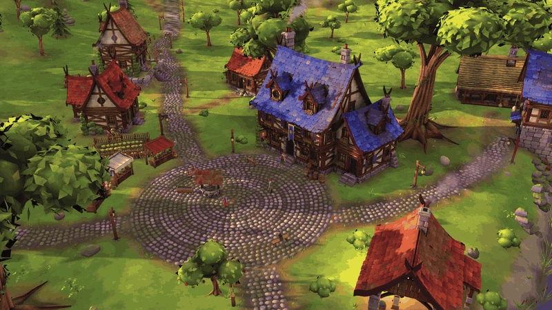
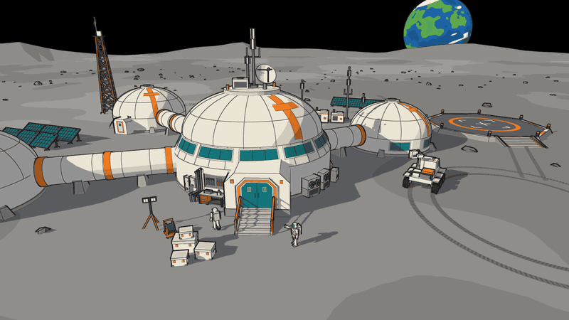
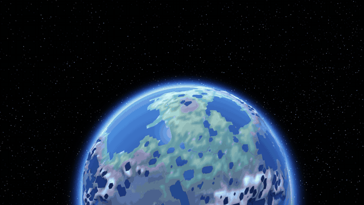
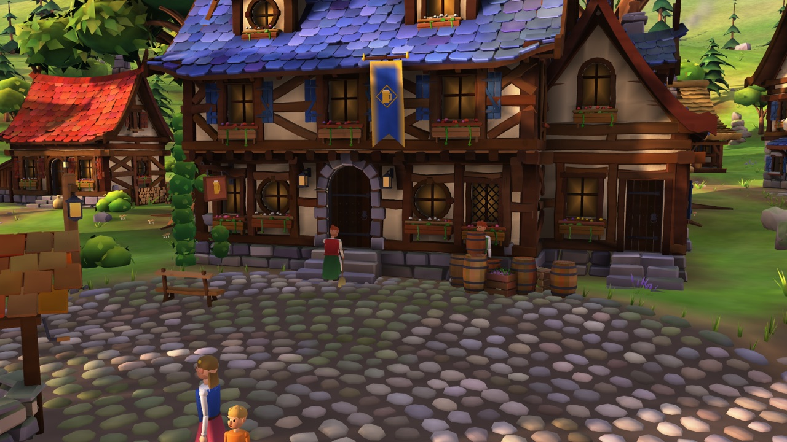

# Wallhammer Web

A 3D engine for the browser where the whole world is written in code: no model files, no texture files, no images.

<a href="examples/fantasy-village/"></a>

[](https://github.com/freema/wallhammer-web/actions/workflows/checks.yml)
[](https://www.npmjs.com/package/wallhammer-web)
[](LICENSE)
[](https://www.typescriptlang.org/)
[](https://developer.mozilla.org/docs/Web/API/WebGL2RenderingContext)

**[Live demos](https://freema.github.io/wallhammer-web/)**: every example runs in the browser, nothing to install (WebGL2 needed).

Wallhammer Web draws with plain WebGL2 and no graphics library, and it loads no images: every mesh and texture comes from code, from generators that are pure functions of their input and a seed, so the same seed always gives the same world. Its simulation runs on integer ticks and millimetres, so the same commands give the same state hash on every machine. World streaming takes a scene from one house up to a solar system, where the camera flies from orbit to a few metres above a surface in one shot, without a loading screen. It is written in strict TypeScript, and its only runtime dependency is `earcut`.

## Install

```sh
npm install wallhammer-web
```

The smallest scene from [Getting started](packages/wallhammer-web/docs/getting-started.md) is a noise hill under a sun: one generator, one material with its GLSL, one layer. It runs in a page with a `<canvas>`, built by a bundler such as Vite.

```ts
import { HEIGHT_FIELD_ATTRIBS, HeightField, PerspectiveOrbitRig, definePalette, heightFieldMesh, streamSeed, valueNoise2 } from 'wallhammer-web';
import type { MaterialDesc } from 'wallhammer-web/base';
import { MeshLayer } from 'wallhammer-web/render';
import { createEngine } from 'wallhammer-web/runtime';

// 1. Data. A generator is a pure function of its input and a seed.
const SIZE_M = 128;
const STEP_M = 2;
const n = SIZE_M / STEP_M + 1;
const seed = streamSeed('demo', 'ground');
const heights = new Float32Array(n * n);
for (let j = 0; j < n; j++) {
  for (let i = 0; i < n; i++) heights[j * n + i] = 12 * valueNoise2(i * STEP_M, j * STEP_M, 40, seed);
}
const field = new HeightField(STEP_M, n, n, heights);

// 2. A material: attribute locations and GLSL per pass. 'depth' uses the shared shadow programs.
const GROUND: MaterialDesc = {
  name: 'ground',
  attribs: HEIGHT_FIELD_ATTRIBS,
  passes: {
    shadow: 'depth',
    color: {
      vs: `#include <header>
in vec3 a_pos;
in vec4 a_normal;
out vec3 v_world;
out vec3 v_normal;
void main() {
  v_world = a_pos;
  v_normal = a_normal.xyz;
  gl_Position = u_viewProj * vec4(a_pos, 1.0);
}`,
      fs: `#include <header>
#include <noise>
#include <lighting>
in vec3 v_world;
in vec3 v_normal;
out vec4 o_color;
void main() {
  vec3 n = normalize(v_normal);
  float sun = sunVisibility(v_world, n, 1.0);
  vec3 c = toDisplay(vec3(0.45, 0.47, 0.3) * lightOn(n, sun, 1.0));
  o_color = vec4(applyFog(c, v_world), 1.0);
}`,
    },
  },
};

// 3. The engine.
const engine = createEngine({
  canvas: document.querySelector<HTMLCanvasElement>('canvas')!,
  view: new PerspectiveOrbitRig({ fovYDeg: 45, minDistance: 20, maxDistance: 400 }, { yawDeg: 30, pitchDeg: 30, distance: 180 }),
  palette: definePalette({ sky: '#8fb2c9' }),
  background: [0.56, 0.7, 0.79],
  environment: { mode: 'day', hour: 15 },
  orbitControls: true,
});
const { renderer, view } = engine;
view.target = [SIZE_M / 2, 0, SIZE_M / 2];
renderer.bounds = { min: [0, field.minY - 4, 0], max: [SIZE_M, field.maxY, SIZE_M] };

// 4. Upload through the renderer and add a layer.
const material = renderer.material(GROUND);
engine.add(new MeshLayer({ material, mesh: renderer.createMesh(heightFieldMesh(field, field.minY - 4), material) }));
engine.start();
```

The [documentation](packages/wallhammer-web/docs/) goes on from there: concepts, every module, recipes for the common extensions and a reference of every entry. Its code samples are type-checked against the package.

## What it can do

| | |
| --- | --- |
| <br>[`outpost`](examples/outpost/): a lunar research station in a comic look, with a rover and astronauts on a skeleton. | <br>[`system`](examples/system/): a descent to the planet Hearth, one of four bodies on their paths round a sun. |
| <br>[`fantasy-village`](examples/fantasy-village/) at street level: timber-framed houses, cobbles and villagers. | <br>[`system`](examples/system/): Hearth from orbit with the marks of its generated plan (rivers and lake edges). |

- **Rendering.** A renderer that draws the layers it is given, materials with GLSL per pass, a shadow map, many point lights, particles and instance sets, and a clear medium below a level (water seen from above and from inside). [Rendering](packages/wallhammer-web/docs/rendering.md)
- **Environment.** The hour and the date with the sun on its path for a place, a moon and stars, a sky or an atmosphere from the ground to orbit, weather (volumetric clouds from the ground to orbit with their shadows, rain under raining clouds, overcast, snow, fog), wind, a cloud cover by place over a planet, and seasons; content adds its own through environment slots. [The environment](packages/wallhammer-web/docs/environment.md)
- **Generators.** Randomness from named hash streams, meshes, textures, and three optional content modules: buildings with roofs, façades and chimneys (`gen-arch`), ground (`gen-ground`) and vegetation (`gen-vegetation`). [Generators](packages/wallhammer-web/docs/generators.md)
- **Simulation.** A deterministic fixed-step simulation driven by a log of commands, with entity tables, navigation, movers, collision modes and agendas. It runs in plain Node too. [Simulation](packages/wallhammer-web/docs/simulation.md)
- **Streaming.** Quadtree cells loaded and unloaded around the viewer, on a plane or a sphere, generated in workers or read from baked files, under a ceiling of GPU memory. [World streaming](packages/wallhammer-web/docs/streaming.md)
- **Walking.** A collision world, a walker that moves over it in fixed steps (with weight and a speed that follows the slope, when asked) and a follow camera behind it; bodies on wheel rays driven over the same world and a body that crawls and glides through the air over it. [Walking](packages/wallhammer-web/docs/walking.md), [Wheeled body](packages/wallhammer-web/docs/wheeled.md), [Flying body](packages/wallhammer-web/docs/flying.md)
- **Motion.** Skeletons posed on the CPU: poses as data, blending, a motion graph of states and layers, a two-bone reach and ends kept on the ground, a body carried at a socket of another, and the steps of several legs. [Motion](packages/wallhammer-web/docs/motion.md)
- **Destruction.** Structures that break part by part: a pure model of what an event breaks and what loses support, then damaged meshes, rubble and falling pieces. [Destruction](packages/wallhammer-web/docs/destruction.md)
- **Planets and systems.** Bodies on rails, positions in 64-bit frames, and one flight from the view of a whole system down to a surface. [Bodies on rails and nested frames](packages/wallhammer-web/docs/frames.md), [The system example](packages/wallhammer-web/docs/system.md)

## Try the examples

Every example runs live at <https://freema.github.io/wallhammer-web/>, built from `main`. To run them locally, everything runs in Docker; the host needs no Node. From the repository root:

```sh
docker compose up -d
```

Then open <http://localhost:5281/>. It lists the examples, each at `http://localhost:5281/<name>/`:

- [`fantasy-village`](examples/fantasy-village/) ([live](https://freema.github.io/wallhammer-web/fantasy-village/)): a living fantasy village made by code (architecture, terrain, vegetation, villagers, smoke and fire, late afternoon to evening). Engine only, with its own content modules in the example.
- [`outpost`](examples/outpost/) ([live](https://freema.github.io/wallhammer-web/outpost/)): a lunar research station in a comic look (flat colours, outlines, hard shadows). Engine only, with its own materials, a rover and astronauts on a skeleton.
- [`system`](examples/system/) ([live](https://freema.github.io/wallhammer-web/system/)): a sun and several bodies on orbits, with one continuous flight from the surface of one body to another, and volumetric clouds over the planet Hearth. Uses the content modules for its structures and their destruction.
- [`planet`](examples/planet/) ([live](https://freema.github.io/wallhammer-web/planet/)): a flight from the surface of a small planet up to orbit and back, with volumetric clouds and rain, biomes and woods, a sea you can dive into and a movie mode (`#movie=1`). Engine only.
- [`endless`](examples/endless/) ([live](https://freema.github.io/wallhammer-web/endless/)): an endless streamed world in quadtree cells, generated in workers or read from baked files, under volumetric clouds (`#vol=0` turns them off). Engine only. A second page, `sphere.html` ([live](https://freema.github.io/wallhammer-web/endless/sphere.html)), shows the sphere world.
- [`destruction`](examples/destruction/) ([live](https://freema.github.io/wallhammer-web/destruction/)): generated structures on plain ground that break part by part. Uses the content modules (`gen-arch`, `sim/destruction`).
- [`movement`](examples/movement/) ([live](https://freema.github.io/wallhammer-web/movement/)): a movement test course: walking, riding a steed, driving cars and flying a glider over a collision world, with a follow camera.
- [`rivers`](examples/rivers/) ([live](https://freema.github.io/wallhammer-web/rivers/)): rivers and paths: an island whose sea, lakes and rivers follow one rule (the ground is cut down to a planned level of water, and water stands wherever the ground lies under it), with footpaths of seven kinds and walkers on them. Engine only.
- [`minimal-3d`](examples/minimal-3d/) ([live](https://freema.github.io/wallhammer-web/minimal-3d/)): a perspective orbit view of an island with standing stones. Engine only.

## Building with an AI agent

The engine is meant to be built on with a coding agent. Its documentation ships in the npm package, so an agent in your project reads the version you installed under `node_modules/wallhammer-web/docs/`:

- [Wallhammer Web for agents](packages/wallhammer-web/docs/agents.md): the one page to read first: the rules for code built on the engine, goal → entry → page → example, the module map, debugging.
- [Cookbook](packages/wallhammer-web/docs/cookbook.md): recipes by goal with checked code, the example to open and the pitfalls.
- [Marks](packages/wallhammer-web/docs/marks.md): pin notes to points of your running scene; the agent lists them, fixes and attaches an after-picture, you accept.

**Claude Code.** The repository is a plugin marketplace with one plugin, `wallhammer`, holding two skills: `wallhammer-build` (rules, where things go, which recipe serves which goal, verifying) and `wallhammer-marks` (working through marks). Install it once:

```text
/plugin marketplace add freema/wallhammer-web
/plugin install wallhammer@wallhammer-web
```

Update it with `/plugin marketplace update wallhammer-web`.

**Codex** (and other agents that read `.agents/skills/`): copy the same skills into your project.

```sh
npx degit freema/wallhammer-web/plugins/wallhammer/skills .agents/skills
```

**One instruction file for both.** Put this line in your project's `AGENTS.md`:

```text
Read node_modules/wallhammer-web/docs/agents.md before writing engine code.
```

and a `CLAUDE.md` that contains only `@AGENTS.md`, so Claude Code and Codex read the same instructions.

## Repository

The repository is a pnpm workspace:

- `packages/wallhammer-web/`: the engine, npm package `wallhammer-web`. Its [`README.md`](packages/wallhammer-web/README.md) describes it, the documentation is in [`docs/`](packages/wallhammer-web/docs/).
- `examples/`: the example pages above, each with its own `README.md`, and `examples/shared/`, code used by more than one example (not a page).
- `tools/`: checks (`layers`, `golden`, `docs`, `pack`, `mesh`, `motion`, `walk`, `follow-check`), the example server (`serve`) with its Vite plugins (`vite`), the static build of the examples (`pages`), pictures in Docker (`shot/page-shot.mjs`), the shader check in Docker (`shot/shader-check.mjs`), host tools (`shot/shot.mjs`, `bench`) and this repository's marks tools and the store's test (`marks`).
- `docker-compose.yml`, `Dockerfile.dev`, `scripts/dev-entrypoint.sh`: the dev container.
- `.claude/skills/` and `CLAUDE.md`: rules and procedures for working with an agent on this repository (running, checks, extending, releasing).
- `.claude-plugin/marketplace.json` and `plugins/wallhammer/`: the Claude Code plugin for projects built on the package (see [Building with an AI agent](#building-with-an-ai-agent)); its version follows the package's.
- `internal/`: internal working material, ignored by git (see [Internal notes](#internal-notes)).

## Running

Everything runs in Docker. The host needs Docker with `docker compose` and git, no Node.

```sh
docker compose up -d     # from the repository root
docker compose ps        # dev should be (healthy)
```

The one service `dev` installs the dependencies, serves every example on one port and stays up for the checks:

| Address | What |
| --- | --- |
| <http://localhost:5281/> | index of the examples |
| <http://localhost:5281/minimal-3d/> | `examples/minimal-3d` |
| <http://localhost:5281/destruction/> | `examples/destruction` |
| <http://localhost:5281/endless/> | `examples/endless` (second page: `/endless/sphere.html`) |
| <http://localhost:5281/planet/> | `examples/planet` |
| <http://localhost:5281/system/> | `examples/system` |
| <http://localhost:5281/fantasy-village/> | `examples/fantasy-village` |
| <http://localhost:5281/movement/> | `examples/movement` |
| <http://localhost:5281/outpost/> | `examples/outpost` |
| <http://localhost:5281/rivers/> | `examples/rivers` |

In general `http://localhost:5281/<name>/` serves `examples/<name>`. Another host port: `EXAMPLES_PORT=5291 docker compose up -d`. Port 5280 is left to the app of the city repository. The service is healthy once the dependencies are installed and the server answers. Stop it with `docker compose down`.

How it works: after the install, `scripts/dev-entrypoint.sh` starts `tools/serve/serve.ts`, one Node process with one HTTP server. Each example has its own Vite dev server in it (with its own `vite.config.ts`), in middleware mode with the base path `/<name>/`. That server starts when the example is first opened, so examples nobody opens cost nothing (no file watching). Source edits reload the page. A restart (`docker compose restart dev`) is needed only after a change of dependencies. Dependencies live in named volumes; nothing is installed on the host disk.

A new example (a folder with `index.html`) shows up in the index by itself. It still needs a volume for its `node_modules` in `docker-compose.yml` and a directory in `Dockerfile.dev`.

### Live demos

```sh
docker compose exec -T dev sh -c 'cd /app && pnpm build:examples'   # dist-pages/: every example and the index, base /
```

`tools/pages/build.ts` builds every example with its own `vite.config.ts` into `dist-pages/<name>/` (ignored by git), every `.html` page of its folder included, and writes the index next to them. `WH_PAGES_BASE` sets the path the site is served under (default `/`). [`pages.yml`](.github/workflows/pages.yml) runs it with `/wallhammer-web/` on every push to `main` that touches the examples, the engine or the tools (or by hand) and deploys the result to <https://freema.github.io/wallhammer-web/>. GitHub Pages sends no special headers; nothing in the examples needs them. The baked cells of `endless` are not in git, so they are not published and `src=files` has nothing to read there.

## Checks

```sh
docker compose exec -T dev sh -c 'cd /app && pnpm typecheck'          # types of the engine and the examples; no error
docker compose exec -T dev sh -c 'cd /app && pnpm check:layers'       # layers: 0 violation(s)
docker compose exec -T dev sh -c 'cd /app && pnpm check:layers:test'  # ok: known-bad fixture fails with all … expected findings
docker compose exec -T dev sh -c 'cd /app && pnpm test:golden'        # golden: N of N generators unchanged, twice (engine set, then examples set)
docker compose exec -T dev sh -c 'cd /app && pnpm check:docs'         # docs: … 0 finding(s)
docker compose exec -T dev sh -c 'cd /app && pnpm check:mesh'         # check:mesh: N/N ok in … ms
docker compose exec -T dev sh -c 'cd /app && pnpm check:motion'       # motion: N of N scenarios ok, … ms
docker compose exec -T dev sh -c 'cd /app && pnpm check:walk'         # walk: N of N scenarios ok, … ms
docker compose exec -T dev sh -c 'cd /app && pnpm check:follow'       # N/N follow cases passed in … ms
docker compose exec -T dev sh -c 'cd /app && pnpm test:marks'         # marks: N of N cases ok
docker compose exec -T dev sh -c 'cd /app && pnpm check:pack'         # ok: the packed package installs, loads and type-checks
docker compose exec -T dev sh -c 'cd /app/examples/planet && pnpm verify'  # planet: all checks passed
```

- `check:layers` guards the module layers, the boundary between the engine, the content modules and the examples, and that WebGL is only in `gpu` and DOM only in `platform`. There are no exceptions.
- `test:golden` runs two sets of fixed recipes and compares the hash of each output with the stored one. First the engine alone (`tools/golden/engine/golden.ts`, hashes in `tools/golden/engine/hashes.json`), then the recipes that need example code (`tools/golden/golden.ts`, hashes in `tools/golden/hashes.json`); the second set runs only when the first passes. `test:golden:engine` and `test:golden:examples` run one set. To accept a deliberate change, run `node tools/golden/engine/golden.ts --accept` or `node tools/golden/golden.ts --accept` in the container. Each rewrites all hashes of its set at once, so read first what changed. Rules: [`docs/tools.md`](packages/wallhammer-web/docs/tools.md).
- `check:docs` type-checks the code samples in the documentation and checks the links.
- `check:mesh` and `check:motion` test, in plain Node, the mesh builder with bare shapes (`gen-mesh`) and the motion module (`motion`).
- `check:walk` tests, in plain Node, the collision world, the walker (including saving and restoring its state), the follow camera and the course of `examples/movement`. It fails also when the run takes over 8 s. `check:follow` tests the follow camera (`FollowRig`).
- `test:marks` tests the marks' dev-server store and the command-line tool `wallhammer-marks` on a scratch folder.
- `check:pack` checks the package in the shape it is published to npm (see below), its `bin` included. It needs the network.
- `pnpm verify` in `examples/planet` is that example's own headless check (generator, flight, streaming, movie). `examples/endless` has one too (`pnpm verify --seed 7`), for its baked cells; it needs `pnpm bake` first and is not part of CI.

## Pictures

### Shader check

The one-off `shaders` service compiles and links the shaders of the example pages in headless Chromium on the software renderer (`tools/shot/shader-check.mjs`, the image of `shot`, profile `tools`; it starts `dev` first when that does not run). It wraps the WebGL2 calls that make programs before a page's scripts run and, after the load, asks for the compile and link status of every program the page made, drawn or not:

```sh
docker compose run --rm shaders                                # every example page, about 1 min
docker compose run --rm shaders --variants                     # and the listed variants, about 2 min (what CI runs)
docker compose run --rm shaders --pages planet,movement        # only these
docker compose run --rm shaders --pages 'planet#extra=lift'    # a page with a hash (another set of programs)
docker compose run --rm shaders --pages endless/sphere.html    # another page of an example
docker compose run --rm shaders --url http://host:port/page/   # any page, not only an example
```

Each page runs in a browser of its own and prints its programs, how many of them no earlier page of the run made (`N new`), its time and phases (load, `__wh.ready`, programs read). A page that fails for a reason other than a broken shader (an exception, a console error, no program, over `--timeout`) is tried once more in a fresh browser and counts only when it fails again. The last line is `shaders: N programs on M pages, K failed, E page errors (T s)`; a failed program prints its info log and source lines, and the exit code is 1 when K or E is not 0. Limits: a program a page makes only in a mode (a key, a later view) is seen only with a `#hash` that turns that mode on; contexts made in workers are not seen; and the GLSL is validated by Chromium's translator, so a fault of one graphics driver's own compiler cannot show. The variants that make programs of their own (the second page of `endless`, the hashes that change the shadows, the depth mapping, the atmosphere or the clouds) are listed in `tools/shot/shader-variants.mjs` and run with `--variants`; a variant whose line says `0 new` adds nothing and does not belong there. Options are in the header of the script. CI runs it with every example page and the variants as its own job of [`checks.yml`](.github/workflows/checks.yml) (`docker compose run --rm shaders --variants`, which builds the images and starts `dev` there too).

### Pictures in Docker

The one-off `shot` service shows whether a page starts in a browser without a WebGL error and how it looks on the software renderer. It runs headless Chromium on the software renderer (profile `tools`, so `up` does not start it; it starts `dev` first when that does not run):

```sh
docker compose run --rm shot --url http://dev:5281/planet/ --presets @hash --size 960x540 --timeout 120000
```

Pictures go to `tools/shot/out/` (ignored by git). The last line is `shot: N pictures, M page errors`. The software renderer is slow: one picture per page and a `--timeout` are enough. The options are in the header of `tools/shot/page-shot.mjs`, the image is built from `tools/shot/Dockerfile`.

`tools/shot/shot.mjs` and `tools/bench/` run on the host instead, because the real graphics card decides the picture and the frame times. See [`docs/tools.md`](packages/wallhammer-web/docs/tools.md).

### Marks

In the dev server, key `N` switches a mark mode in the `planet` (free camera), `endless` (free camera), `movement`, `minimal-3d`, `destruction`, `outpost`, `fantasy-village` (orbit view) and `rivers` examples, and key `K` in `system` near a body (N toggles the names there): a click picks the point under the cursor, a note is typed, and the mark is saved with the point, the view, a picture and facts of the place to `internal/marks/` (ignored by git). The panel, the store and the command-line tool `wallhammer-marks` are part of the package (`installMarking` in `platform`, `wallhammer-web/marks-store`). In this repository `tools/marks/list.mjs` lists the marks and `set.mjs` changes their status (the package's tool with this repository's folder and server), `shoot.mjs` takes a picture of a mark's view after a repair on the host GPU. See [Marks](packages/wallhammer-web/docs/marks.md) and the skill `wallhammer-marks`.

## npm package

In the workspace the package exports the TypeScript sources (`exports` → `src/`), so the examples see an engine change at once. The published package contains built JavaScript with type declarations (`dist/`), the documentation, `README.md` and `LICENSE`. `prepack` builds it (`tsc -p tsconfig.build.json`), and `publishConfig.exports` in [`package.json`](packages/wallhammer-web/package.json) swaps the entries.

Only `packages/wallhammer-web` is published. The examples are private workspace packages: they are never published and import the engine source through the workspace.

### Release

Publishing runs on GitHub ([`publish.yml`](.github/workflows/publish.yml)) when a release is published:

1. Set the version in `packages/wallhammer-web/package.json`, commit and push to `main`.
2. Publish a GitHub release with the tag `v<version>`, e.g. `gh release create v0.8.3 --generate-notes`.
3. The workflow runs all checks ([`checks.yml`](.github/workflows/checks.yml), the same ones that run on every push and pull request), compares the tag with the package version, packs with `pnpm pack` and publishes the tarball with `npm publish`. A prerelease version (`1.2.3-beta.1`) goes under the `beta` dist-tag.

It signs in through npm trusted publishing (OIDC), so there is no token and no secret. This is set once on npmjs.com, in the settings of the package under "Trusted Publisher": GitHub Actions, owner `freema`, repository `wallhammer-web`, workflow `publish.yml`. npm offers that setting only for a package that exists, so the very first version is published by hand (below).

### By hand

Publishing by hand stays possible. Login and publishing run in the container; the host has no Node:

```sh
docker compose exec -T dev sh -c 'cd /app && pnpm check:pack'                          # check first
docker compose exec dev sh -c 'cd /app/packages/wallhammer-web && npm login'           # once; the login stays in the container
docker compose exec dev sh -c 'cd /app/packages/wallhammer-web && pnpm publish --no-git-checks'
```

- Publish with `pnpm publish`, not `npm publish`: only pnpm applies `publishConfig.exports`. A package from `npm publish` would point to `src/`, which it does not contain.
- Set the version beforehand in `packages/wallhammer-web/package.json` (now `0.8.3`). A version once published cannot be overwritten on npm.
- `--no-git-checks`: the container has no git, so pnpm cannot check the branch there. Check on the host beforehand that the working tree is clean and on `main` (`git status`).
- A new entry `wallhammer-web/<module>` is written twice: in `exports` and in `publishConfig.exports`. `check:pack` finds a missing twin.

## Origin

The engine started in the repository of the Ústí city model, in `web/packages/wallhammer-web`. This repository began as a hard copy of it at commit `aba73fe` (version 0.4.0, including walking through the world) and is now the only place where the engine is developed. After that, work left unfinished in the city repository on top of this version moved here as well: the motion module `motion` (skeletons, poses, motion graph), the mesh builder with bare shapes (`gen-mesh`), 3×4 matrices (`base`), bone-driven instances (`render`), solid bodies from meshes and saved walker state (`world`), and the checks `check:mesh` and `check:motion`.

The examples and their tools were developed in a sibling folder that mounted the engine from the city repository. They now live here too.

The golden hashes guard the copy: the 72 engine recipes give the same hashes here as in the original repository. Four recipes there depended on code of the city app (people, vehicles, stops, landmark buildings) and stayed with the app.

## Copy in the city repository

The Ústí city model repository keeps a hard copy of version 0.4.0 in `web/packages/wallhammer-web` for its app and may change it for its own needs. So that the two copies do not drift apart unseen, a rule applies there: every change to that copy is also sent here as an issue or a pull request (what changed, why, a link to the commit). This repository decides whether the engine takes it over, and the answer goes into the same issue. In the other direction, a newer engine is taken into the city repository only deliberately, in one pull request with the checks of that repository.

The two copies are synchronised by hand, never automatically, and only when the owner asks for it. Work in this repository does not edit the city repository.

## Internal notes

`internal/` at the repository root is ignored by git, as are files named `*.local.md`. Internal working material goes there: notes, plans, research, reports and drafts. It is never committed.

## Contributing

See [`CONTRIBUTING.md`](CONTRIBUTING.md) for the setup, the checks and the rules, [`SECURITY.md`](SECURITY.md) for reporting a vulnerability and [`CHANGELOG.md`](CHANGELOG.md) for what changed between versions.

## Licence

MIT, full text in [`LICENSE`](LICENSE). The same file is in the package (`packages/wallhammer-web/LICENSE`).
